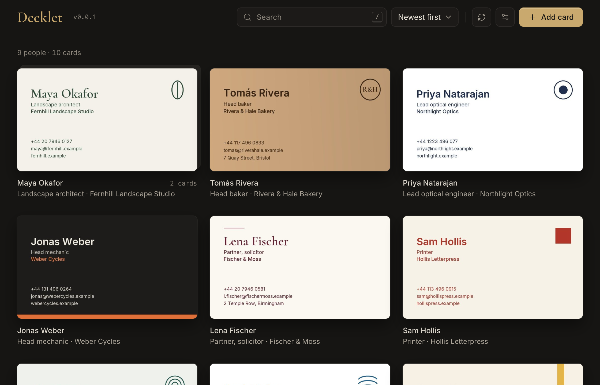
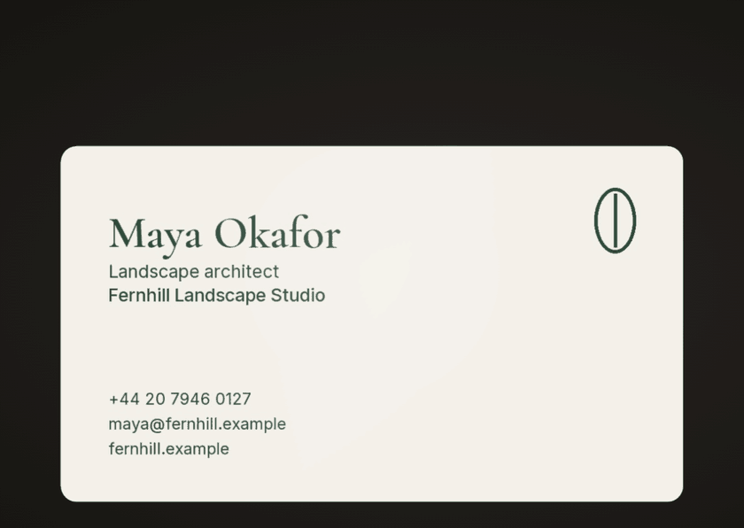
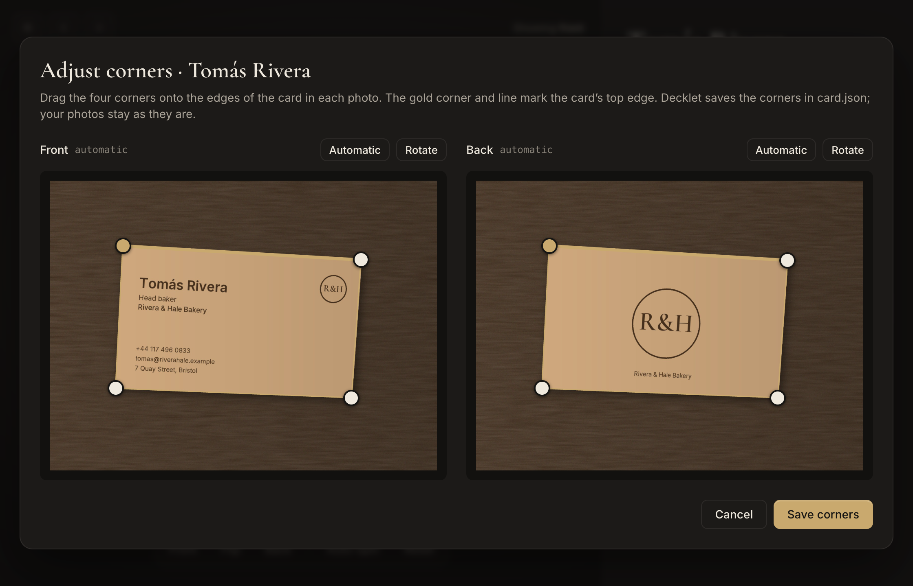
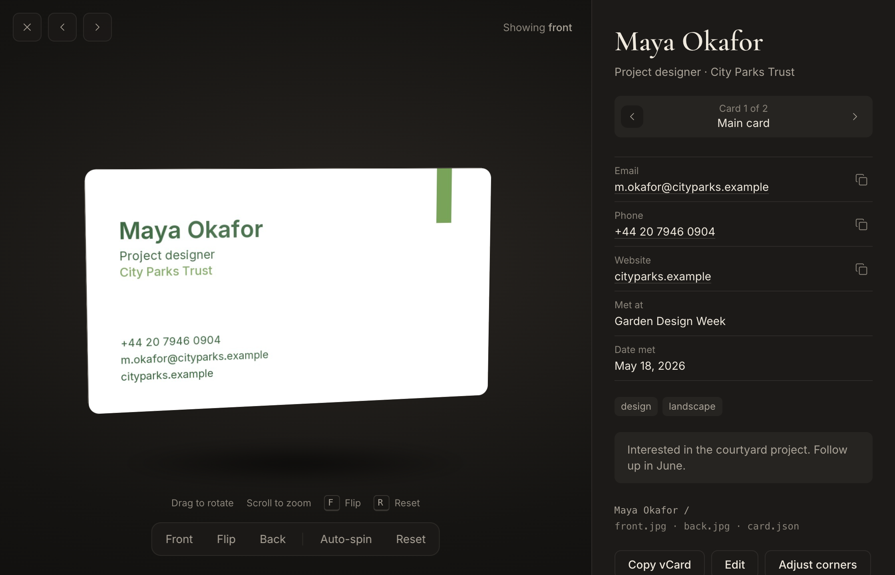
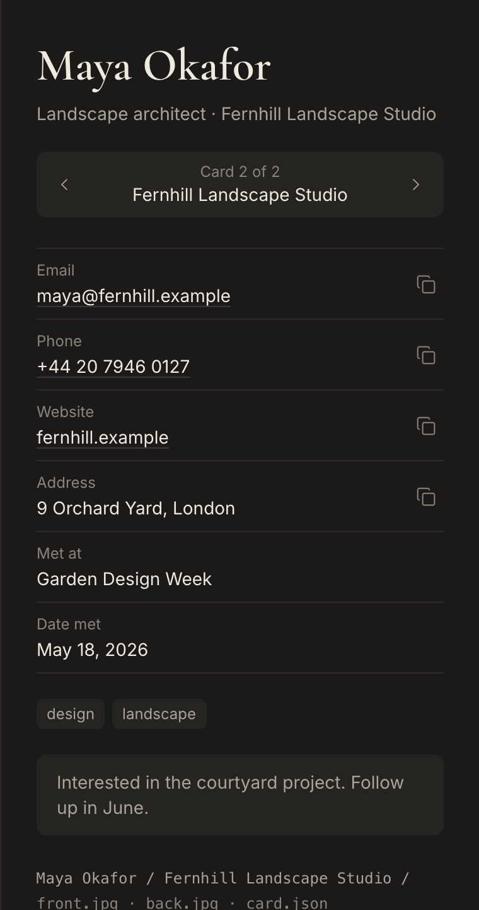
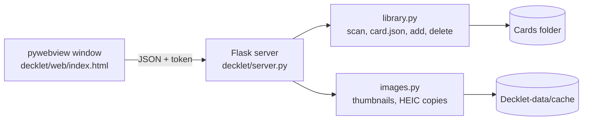

Keep your paper business cards as photos and turn them over in 3D, like holding the real card. Works offline. Sends no data.

**Contents:** [What it does](#what-it-does) · [Privacy](#privacy) · [Download](#download) · [How to use](#how-to-use) · [For developers](#for-developers) · [Licence](#licence)



## What it does

Decklet shows the business cards in one folder on your computer. Each person is a subfolder with a photo of the front and the back, plus one more subfolder for each extra card they gave you. Decklet reads that folder. It does not keep its own copy of your cards.

### A gallery of every card

Each person shows as a photo tile of their newest card. A person with more than one card shows a small stack and the number of cards. Search by name, company, tag or notes, and sort by newest, name or company.

### Turn a card over in 3D



Select a card to see it in 3D. Drag to rotate it, scroll to zoom, and double-click to flip it. The light moves across the card as it turns.

### Front and back always line up



Decklet finds the edges of the card in each photo, straightens it and crops away the table around it. The front and back come out exactly the same size, so the 3D card has clean edges even when the two photos were taken differently. If Decklet misses an edge, drag the corners into place yourself with **Adjust corners**.

### Every card someone gave you



When someone gives you a new card, for example after they change jobs, add it to the same person. Their name, tags and notes stay shared. Each card keeps its own company, role, email, phone, website and address.

### Contact details next to the card



The panel beside the card shows the name, role, company, email, phone, website, address, where you met, tags and notes. Copy any detail with one click, or copy the whole card as a vCard for your contacts app.

### Your folder stays yours

Decklet never moves, renames or changes your photos. Straightened copies for the 3D view are kept in Decklet's own folder. Decklet writes a small `card.json` file only when you edit a card or adjust its corners. Delete moves the folder into a `_deleted` folder. Nothing is removed for good.

## Privacy

- Decklet works offline. Your cards never leave your computer.
- No accounts, no tracking, no adverts.
- Your cards stay in the folder you choose. Decklet's own settings, thumbnails, straightened copies of your photos and log file are kept in the `Decklet-data` folder next to the app.
- The app keeps a log file, `Decklet.log`, in the `Decklet-data` folder. It records what the app does and any errors, including file names, to help fix problems. It never leaves your computer unless you send it. To find it, select **View Logs** in Settings.
- When you select the version number, the app asks GitHub (api.github.com) for the latest release. It sends nothing else and nothing is downloaded.
- Report a Problem opens a page on GitHub in your browser. Nothing is sent until you submit it there.

## Download

Decklet runs on Windows 10 or later, macOS 13 or later on Apple Silicon (M1 or newer), and Linux.

1. Go to the [Releases page](https://github.com/TariqMK/Decklet/releases/latest).
2. Download the file for your computer:
   - Windows: `Decklet-vX.Y.Z-windows-x64.exe`
   - macOS: `Decklet-vX.Y.Z-macos-arm64.zip`. Open the zip to get `Decklet.app`.
   - Linux: `Decklet-vX.Y.Z-linux-x64.tar.gz`. Extract it to get `Decklet`.
3. Put the app in a folder of its own, for example `Documents/Decklet`.

> [!NOTE]
> Decklet makes a `Decklet-data` folder next to the app the first time it starts. To move Decklet to another computer, copy the app and this folder together.

### Opening on macOS

Decklet isn't notarised by Apple, so macOS shows a warning the first time you open it. This is expected and doesn't mean the app is harmful.

1. Open Decklet and click **Done** on the warning.
2. Open **System Settings → Privacy & Security**, scroll down to the message saying "Decklet" was blocked, and click **Open Anyway**.
3. Enter your password, then click **Open** on the next prompt. You only need to do this once.

<details>
<summary>If you use Terminal</summary>

You can run this instead:

    xattr -dr com.apple.quarantine "/Applications/Decklet.app"

</details>

## How to use

### Set up your cards folder

Make one folder for your cards, for example `Business Cards`. Put one subfolder in it for each person. For each extra card from the same person, put a subfolder inside their folder:

```
Business Cards/
├── Maya Okafor/
│   ├── front.jpg          (her main card)
│   ├── back.jpg
│   ├── card.json          (optional, Decklet makes it when you edit)
│   └── Halcyon 2026/      (another card from Maya)
│       ├── front.jpg
│       ├── back.jpg
│       └── card.json      (optional, details printed on this card)
└── Elias Brandt/
    ├── front.jpg
    └── back.jpg
```

- The person's folder name is their name until you edit the card.
- Photos can be `.jpg`, `.jpeg`, `.png`, `.webp` or `.heic`.
- Name the photos `front` and `back`. If they have other names, Decklet uses the first one in alphabetical order as the front and the second as the back. A single photo is the front.
- A person can have only card subfolders and no photos of their own.
- Decklet skips folders whose names start with `_` or `.`.
- The person's `card.json` holds their name, tags, notes and where you met. A card subfolder's `card.json` holds the company, role, email, phone, website and address printed on that card. A card subfolder without `card.json` shows the person's details.

### Open your cards

1. Start Decklet.
2. Select **Choose folder…** and select your cards folder. Decklet remembers it.
3. Select a card to open it in 3D.

To use a different folder later, select **Settings** (the sliders button at the top right), then **Change folder…**.

### Look at a card

| To do this | Do this |
|---|---|
| Rotate the card | Drag it |
| Zoom | Scroll |
| Flip the card | Double-click, press **F** or select **Flip** |
| Show the front or back | Select **Front** or **Back** |
| Spin the card slowly | Select **Auto-spin** |
| Straighten the card | Press **R** or select **Reset** |
| Next or previous person | Press **→** or **←** |
| Next or previous card of the same person | Press **↓** or **↑**, or use the arrows next to **Card 1 of 2** in the panel |
| Close the 3D view | Press **Esc** |
| Search | Press **/** |

### Add a card

1. Select **Add card**.
2. Drop the front photo on **Front** and the back photo on **Back**. You can also drop both photos on **Front** at once.
3. Type the name and any other details.
4. Select **Save card**.

Decklet makes a new folder with the person's name. It copies the photos in as `front` and `back` and writes `card.json`. Your original photos stay where they are.

### Add another card for the same person

1. Open one of the person's cards.
2. Select **Add card for** and the person's first name, for example **Add card for Maya**.
3. Type a **Card name**, for example `Halcyon 2026`. If you leave it empty, Decklet uses the company and the year.
4. Drop the photos and type the details printed on this card.
5. Select **Save card**.

Decklet makes the card name a subfolder inside the person's folder and copies the photos in.

### Line up the front and back

Decklet straightens every card on its own. If the edges look wrong:

1. Open the card.
2. Select **Adjust corners**.
3. Drag the four corners onto the corners of the card in each photo. The gold corner and line mark the card's top edge.
4. If the card comes out on its side, select **Rotate** until the gold line is along the top.
5. Select **Save corners**.

To go back to Decklet's own corners, select **Automatic**, then **Save corners**. Decklet saves the corners in the card's `card.json`. The photos are not changed.

### Edit a card

1. Open the card.
2. Select **Edit**.
3. Change the details and select **Save card**.

Decklet saves the name, tags, notes and where you met in the person's `card.json`. It saves the details printed on the card in that card's `card.json`. The folder names and the photos stay the same. If a card has no back photo yet, you can add one in **Edit**. To change a photo that is already there, replace the file in the folder and select **Rescan**.

### Delete a card

1. Open the card.
2. Select **Delete**. The button asks what it will move, for example **Move “Halcyon 2026” to _deleted?**. Select it again within 3 seconds.

> [!WARNING]
> Delete on a person's main card moves the whole person folder, with all their cards. Delete on a card subfolder moves only that card.

Decklet moves the folder into `_deleted` inside your cards folder. A single card is named after the person and the card, for example `Maya Okafor - Halcyon 2026`. To bring a card back, move its folder back where it was and select **Rescan**.

### See changes made in the folder

Decklet reads the folder when it starts. If you add or change files in the folder while Decklet is open, select **Rescan** (the circular arrows button at the top right).

### Check for updates

1. Select the version number next to the Decklet title.
2. If a newer version is available, select **Open release page** to download it.

### Report a problem

1. Select **Settings** (the sliders button).
2. Select **Report a Problem…**. The bug form opens on GitHub with your Decklet version and operating system filled in.
3. Select **View Logs** in Settings to find the log file, and drag it into the form.

You need a free GitHub account to send a report. You can also use these links: [Report a bug](https://github.com/TariqMK/Decklet/issues/new?template=bug.yml) · [Suggest an idea](https://github.com/TariqMK/Decklet/issues/new?template=idea.yml).

## For developers

Building the app yourself or changing it? Everything you need is below.

<details>
<summary><strong>Run from source</strong></summary>

You need Python 3.11 or later.

```bash
git clone https://github.com/TariqMK/Decklet.git
cd Decklet
python -m venv .venv
source .venv/bin/activate        # Windows: .venv\Scripts\activate
pip install -e ".[dev]"
python -m decklet
```

Run from source, Decklet keeps its data in `Decklet-data/` in the project folder. Set the `DECKLET_DATA_DIR` environment variable to use another folder.

On Linux, Decklet uses the Qt web view (PyQt6-WebEngine), which pip installs.

</details>

<details>
<summary><strong>Run the tests</strong></summary>

```bash
pytest -q
ruff check .
```

</details>

<details>
<summary><strong>How it works</strong></summary>

Decklet is a Python app. A Flask server runs on `127.0.0.1` with a random port. A pywebview window shows the page from that server. Every API call needs a random token that the server puts in the page, so other programs and web pages can't use the API.



| File | Job |
|---|---|
| `decklet/__main__.py` | Starts logging, the server and the window |
| `decklet/server.py` | Routes for the page, images and the JSON API |
| `decklet/library.py` | Reads person folders and their card subfolders. Writes `card.json`, new folders and `_deleted` moves |
| `decklet/images.py` | Finds the card's corners (OpenCV), makes straightened faces of the same size, thumbnails and HEIC copies, all in `Decklet-data/cache` |
| `decklet/paths.py` | Data folder next to the app, bundled files, `settings.json` |
| `decklet/app_log.py` | `Decklet.log` and View Logs |
| `decklet/update_check.py` | The manual update check |
| `decklet/web/` | The page, with bundled Inter and Cormorant Garamond fonts |
| `assets/icon/` | The icon masters (`decklet.svg`, and `decklet-small.svg` for 16 to 32 px) and the built `.png`, `.ico` and `.icns` |
| `assets/make_assets.py` | Builds the icon files, `decklet/icon.png`, `assets/banner.png`, `assets/social-card.png` and `assets/brand-board.png` |
| `assets/make_screenshots.py` | Retakes the README screenshots and the 3D GIF with made-up sample cards |

</details>

<details>
<summary><strong>Update the screenshots and brand images</strong></summary>

1. Install the brand tools:

   ```bash
   pip install -e ".[brand]"
   playwright install chromium
   ```

2. Rebuild the icon files, banner and social card after a change to `assets/icon/*.svg` or the tagline:

   ```bash
   python assets/make_assets.py
   ```

3. Retake the screenshots and the GIF after a UI change:

   ```bash
   python assets/make_screenshots.py
   ```

The screenshot script makes fictional cards in a temporary folder and starts Decklet with a temporary data folder. It does not read your cards folder or settings, and it sends no network traffic. The version label shows the newest release tag.

</details>

<details>
<summary><strong>Creating a Release</strong></summary>

1. Open the **Actions** tab on GitHub and select **Release**.
2. Select **Run workflow**.
3. In **Use workflow from**, select `main` for a normal release.
4. Select the **Version bump**: `patch` (1.2.3 → 1.2.4), `minor` (1.2.3 → 1.3.0) or `major` (1.2.3 → 2.0.0).
5. Select the **Release type**: `draft` (only you can see it) or `public`.
6. Select **Run workflow**.

The workflow runs the tests first. It then builds Windows x64 (`.exe`), macOS Apple Silicon (`.zip`) and Linux x64 (`.tar.gz`). It makes the release only when all three builds succeed. The next version comes from the highest `vX.Y.Z` tag or release, drafts included. The workflow writes the version into the build only. It never commits to the repository.

**Branch builds:** select another branch in **Use workflow from** to make a test build. Its version looks like `v1.5.0-new-sync.1`. A public branch build is a GitHub pre-release and is never offered as the latest release.

No secrets are needed. The builds are not signed.

</details>

## Licence

Decklet is free software under the [GNU General Public License v3.0](LICENSE). The bundled fonts, Inter and Cormorant Garamond, use the SIL Open Font License (`decklet/web/fonts/`).
